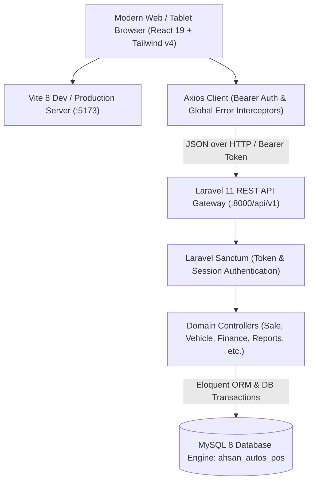

# 🚗 Ahsan Autos POS & Dealership Management System

> **Enterprise-Grade Point of Sale (POS), Vehicle Inventory Fleet, Treasury & Dealership ERP**  
> Custom-engineered for Pakistani Used-Car Showrooms and Automotive Dealerships.

[](https://laravel.com)
[](https://react.dev)
[](https://vitejs.dev)
[](https://tailwindcss.com)
[](https://www.mysql.com)
[](LICENSE)

---

## 📌 Executive Overview

**Ahsan Autos POS** is an end-to-end automotive management and point-of-sale platform developed to resolve the operational and financial complexities of vehicle trading in Pakistan (specifically calibrated for high-volume markets like Islamabad / Rawalpindi Faizabad interchange).

Unlike generic retail POS systems, Ahsan Autos POS is purpose-built with:
- **Multi-tier Vehicle Ownership**: Separate accounting for *Showroom-Owned*, *Client Consignment*, and *Investor-Funded* vehicles.
- **6-Seals Condition Scoring & Vehicle Dossier**: Inspection scoring (Pillars, Bonnet, Boot, Doors, Engine compression, Suspension) and document compliance tracking (Original Smart Card, File, Return File, Biometric, Excise NOC).
- **Double-Sale Prevention**: Real-time locking and inventory isolation ensuring a reserved or sold car cannot be double-booked.
- **Showroom Cash Safe & Double-Entry Treasury**: Physical cash drawer float (`Opening Float + Cash Inflows - Cash Outflows`), multi-bank balances (Meezan, HBL), and refurbishment expense capitalization into vehicle cost.
- **Atomic Deal Closures**: Simultaneous ledger journaling, invoice generation, vehicle status update, and profit calculations in a single transaction.
- **Legal Print Center & WhatsApp Invoicing**: 80mm thermal receipts, A4 Bayana / Ikranama stamp paper sale deeds, gate delivery passes, and direct WhatsApp invoice dispatch.

---

## 🏗️ System Architecture

The project is structured as a decoupled monorepo:



---

## 📂 Repository Structure

```text
Ahsan autos/
├── backend/                       # Laravel 11 Backend API Engine
│   ├── app/
│   │   ├── Http/Controllers/Api/  # REST API Controllers (Sale, Vehicle, Finance, Report, etc.)
│   │   └── Models/                # Eloquent Models (16 Domain Models)
│   ├── bootstrap/                 # Application bootstrap & middleware
│   ├── database/
│   │   ├── migrations/            # 6 Structured schema migrations
│   │   ├── seeders/               # ShowroomSeeder (Users, Roles, Vehicles, Accounts, Leads)
│   │   └── schema.sql             # Direct MySQL SQL dump (Alternative DB setup)
│   ├── routes/
│   │   └── api.php                # REST API v1 routing table
│   ├── .env.example               # Backend environment template
│   └── composer.json              # PHP dependencies (PHP 8.2+, Laravel 11, Sanctum)
│
├── frontend/                      # React 19 + Vite Frontend SPA
│   ├── public/                    # Static assets & favicon
│   ├── src/
│   │   ├── assets/                # Images, vehicle illustrations
│   │   ├── components/            # Modular React components
│   │   │   ├── auth/              # Protected routes & login guard
│   │   │   ├── common/            # Modals, badges, search bars, pagination
│   │   │   ├── layout/            # Sidebar, Header, Navbar, Breadcrumbs
│   │   │   ├── printing/          # 80mm Thermal, A4 Stamp Deed, Gate Pass slips
│   │   │   └── ui/                # Glassmorphic UI elements
│   │   ├── context/               # AuthContext & ToastContext providers
│   │   ├── pages/                 # 14 Full-featured application pages
│   │   ├── services/              # API layer & offline storage fallback engines
│   │   ├── styles/                # Custom CSS animations & print media stylesheets
│   │   ├── App.jsx                # Router configuration & route tree
│   │   ├── main.jsx               # Application entry point
│   │   └── index.css              # Tailwind CSS v4 & custom root theme tokens
│   ├── .env.example               # Frontend environment template
│   ├── package.json               # Node dependencies (React 19, Lucide, Tailwind v4)
│   └── vite.config.js             # Vite configuration with strict port 5173
│
└── README.md                      # Project master documentation (This file)
```

---

## ⚡ Core Business Modules

### 1. 🏎️ POS Sales Terminal (`/pos-terminal`)
- Rapid vehicle checkout and auto accessories / spare parts point of sale.
- Quick brand filter pills: **Toyota, Honda, Suzuki, KIA, Hyundai, Changan, MG, Haval**.
- Flexible settlement: Full Cash, Bank Wire (Meezan/HBL), or Credit/Token Advance.
- Instant 80mm thermal receipt printing and 1-click WhatsApp customer invoice dispatch.

### 2. 🚘 Vehicle Fleet & Inventory (`/vehicles`)
- Real-time status lifecycle: `Available` ➔ `Reserved` ➔ `Sold` ➔ `In Refurbishment`.
- 360° Inspection details: Exterior, interior, engine sound, suspension, tyres, AC performance.
- 6-Seals authentication score (Bonnet, Trunk, Pillars, Doors).
- Digital Document Safe: Tracking original registration book, computerized smart card, excise file, return file, and biometric status.

### 3. 📋 Car Demand Sheet & AI Matchmaker (`/car-demand`)
- Capture customer requirements (Make, model year, budget ceiling, fuel type, transmission).
- Algorithmic matchmaker scoring (0% – 100%) checking current unsold inventory against active buyer leads.

### 4. 📝 Inward Vehicle Purchases (`/purchases`)
- Seller acquisition deeds with CNIC, biometric records, and verification.
- Token advance tracking, staged milestone installments, and direct cash ledger integration.

### 5. 🛒 Sales Orders & Atomic Gross Profit (`/sales`)
- Atomic deal closing with automated net profit calculation:
  $$\text{Gross Profit} = \text{Sale Price} - (\text{Purchase Cost} + \text{Refurbishment Expenses}) - \text{Brokerage} - \text{Staff Commission}$$
- Client Consignment mode: Protects client base price and records only showroom commission as company earnings.
- Safe 1-click Void / Sale Cancellation restoring stock and reversing accounting journals.

### 6. 💼 Financial Treasury & Cash Safe (`/cash-finance`, `/expenses`)
- Real-time physical drawer formula:
  $$\text{Cash in Hand} = \text{Opening Float} + \text{Cash Inflows} - \text{Cash Outflows}$$
- 12 Expense heads (Detailing, Mechanical, Denting & Painting, Fuel, Rent, Utility bills, etc.).
- Direct vehicle cost capitalization (`totalExpenses` automatically added to vehicle net cost).
- Safe-to-Bank and Bank-to-Safe internal liquidity transfers.

### 7. 🤝 Multi-Tier Commission Register (`/commission`)
- Multi-party commission splits: Showroom commission, external car brokers/agents, and internal sales staff bonuses.
- Commission settlement tracking with payout vouchers.

### 8. 📊 20 Specialized Automotive BI Reports (`/reports`)
1. Daily Sales Summary
2. Monthly Sales Performance
3. Vehicle Sales Register
4. Vehicle Purchases Register
5. Inventory Stock Valuation
6. Unsold Vehicle Aging Analysis
7. Sold Vehicles Historical Archive
8. Showroom-Owned Assets
9. Client Consignment Ledger
10. Investor-Syndicate Portfolios
11. Vehicle Profitability Breakdown
12. Comprehensive Profit & Loss (EBITDA)
13. Cash Flow Statement
14. Real-time Cash in Hand Drawer Float
15. Commissions & Brokerage Register
16. External Broker Commission Ledger
17. Showroom Operating Expense Breakdown
18. Vehicle Refurbishment Expenses Ledger
19. Outstanding Customer Receivables
20. Seller Liabilities & Payables
- One-click CSV / Excel export and formatted print previews for every report.

### 9. 🖨️ Automotive Print & Legal Document Center (`/print-center`)
- **8 Pre-formatted Legal and Operational Document Templates**:
  1. **80mm Thermal POS Sales Slip** (Compact POS printer receipt)
  2. **Legal Stamp Paper Vehicle Sale Deed** (Ikranama / Bayana agreement with legal terms)
  3. **Vehicle Inward Purchase Agreement** (Formal seller transfer contract)
  4. **Commission Settlement Voucher** (Broker payout receipt)
  5. **Vehicle Gate Pass & Delivery Order** (Security release document)
  6. **360° Comprehensive Vehicle Dossier** (Inspection sheet & full vehicle history)
  7. **Cash Receipt Voucher** (Formal double-entry receipt)
  8. **Daily Cash Safe Closing Certificate** (End-of-day drawer reconciliation)

### 10. 🔒 Role-Based Access Control (RBAC) & Settings (`/settings`)
- 4 Granular Showroom Roles: **Admin (Owner)**, **Manager**, **Sales Staff**, **Accountant**.
- Custom showroom identity: Business name, NTN/STRN, showroom address, contact numbers, and invoice footer notes.

---

## 🚀 Quick Setup & Installation Guide

### Prerequisites
Make sure your development machine has:
- **PHP** `>= 8.2` with `pdo_mysql`, `mbstring`, `openssl`, `curl` extensions enabled
- **Composer** (PHP dependency manager)
- **Node.js** `>= 18.0.0` & **npm**
- **MySQL Server** (XAMPP / MariaDB / Laragon / Standalone MySQL)

---

### Step 1: Database Setup
1. Start your MySQL Server (Default Port: `3306`).
2. Create an empty database named `ahsan_autos_pos`:
   ```sql
   CREATE DATABASE ahsan_autos_pos CHARACTER SET utf8mb4 COLLATE utf8mb4_unicode_ci;
   ```
3. *(Alternative Option)*: If you prefer importing raw SQL instead of running Laravel migrations, import the pre-built schema file directly:
   ```bash
   mysql -u root -p ahsan_autos_pos < backend/database/schema.sql
   ```

---

### Step 2: Backend Installation (Laravel 11)
```bash
# 1. Navigate to backend directory
cd backend

# 2. Install PHP dependencies
composer install

# 3. Configure environment file
copy .env.example .env

# 4. Generate application key
php artisan key:generate

# 5. Run database migrations & seed realistic showroom data
php artisan migrate:fresh --seed

# 6. Launch the backend API server
php artisan serve --port=8000
```
> The API server will be live at: **`http://localhost:8000/api/v1`**  
> Health check endpoint: **`http://localhost:8000/api/v1/health`**

---

### Step 3: Frontend Installation (React 19 + Vite)
Open a new terminal window:
```bash
# 1. Navigate to frontend directory
cd frontend

# 2. Install Node dependencies
npm install

# 3. Configure environment file
copy .env.example .env

# 4. Launch the frontend development server
npm run dev
```
> Open your browser and navigate to: **`http://localhost:5173`**

---

## 🔑 Default Seed Credentials

All accounts come pre-seeded with realistic Pakistani showroom data:

| Role | Username | Password | Access Level & Responsibilities |
| :--- | :--- | :--- | :--- |
| 👑 **Admin (Owner)** | `admin` | `admin123` | **Full Wildcard Access (`*`)**: Unrestricted P&L, system config, users, data export |
| 👔 **Manager** | `manager` | `manager123` | **Operations Lead**: Deal closing, stock editing, purchases, commission payouts |
| 🎯 **Sales Staff** | `sales` | `sales123` | **Floor Sales Agent**: POS terminal, customer bookings, vehicle catalog (Cost prices masked) |
| 🧮 **Accountant** | `accountant` | `accountant123` | **Financial Controller**: Cash Safe ledger, expense vouchers, BI audits (Stock delete blocked) |

---

## 📡 REST API Route Highlights (`/api/v1`)

| Method | Endpoint | Description |
| :--- | :--- | :--- |
| `POST` | `/auth/login` | Authenticate user & issue Sanctum Bearer token |
| `GET` | `/auth/me` | Fetch active user profile, permissions & showroom profile |
| `GET` | `/vehicles` | List vehicle catalog with filters (status, make, price range) |
| `POST` | `/vehicles` | Add new vehicle to showroom fleet with 6-seals score |
| `POST` | `/purchases` | Create inward acquisition deed & token advance |
| `POST` | `/sales` | Atomic checkout: close sale, generate invoice, deduct stock |
| `POST` | `/sales/{id}/payment` | Record installment or remaining balance payment |
| `POST` | `/sales/{id}/void` | Void sale: restore vehicle to stock and reverse ledger |
| `GET` | `/finance/summary` | Real-time cash safe float & multi-bank balances |
| `POST` | `/finance/expenses` | Post operational expense & capitalize vehicle refurbishment |
| `GET` | `/demands` | View car demand leads & matchmaker scoring |
| `GET` | `/reports/{reportId}` | Generate any of the 20 specialized automotive BI reports |
| `GET` | `/settings` | Fetch showroom configuration & print preferences |

---

## 📱 Device & Display Support

- **Desktop (1080p, 2K, 4K)**: High-density luxury dashboard, side-by-side deal closer, multi-column inventory tables.
- **Tablets & iPads**: Touch-optimized POS product grid, responsive modal dialogs.
- **Mobile Phones**: Bottom-sheet drawers, swipeable brand filters, single-column quick checkout.
- **Hardware Printing**: Supported across standard 80mm ESC/POS Thermal Printers and standard A4 Laser / Inkjet Printers.

---

## 🏢 System Branding & Credits

**Ahsan Autos Showroom & POS Terminal**  
*Main IJP Road, Near Faizabad Interchange, Islamabad / Rawalpindi, Pakistan*  

**Engineered by Rojrztech**  
- 📞 **Support Phone**: `03132066883` / `03151210736`  
- 🌐 **Official Website**: [Rojrztech.com](https://rojrztech.com)  

---
*Ahsan Autos POS — Built with precision for automotive excellence.*
